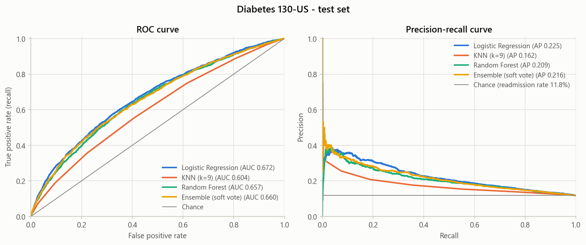
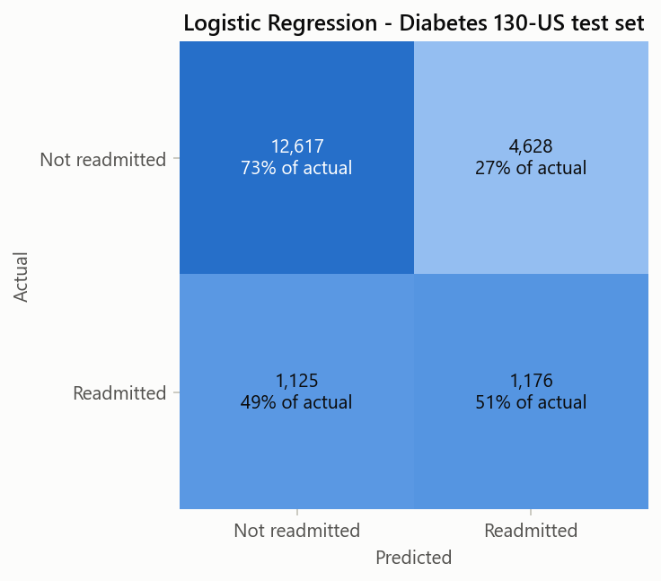
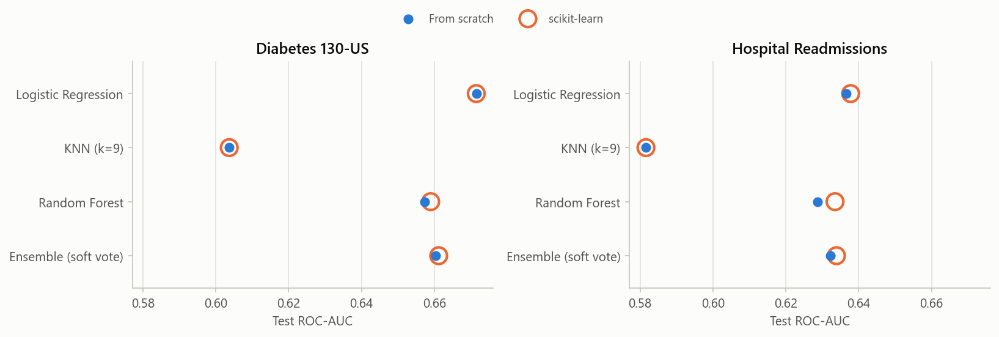
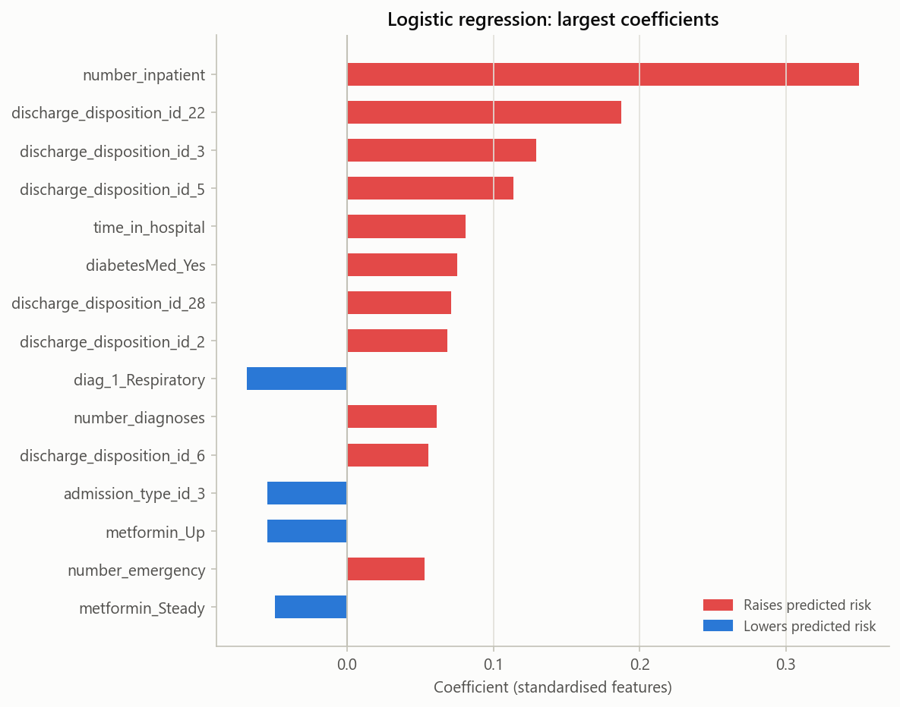

# Predicting 30-Day Hospital Readmission of Diabetic Patients

Logistic regression, k-nearest neighbours, a decision tree, a random forest and a soft-voting ensemble written from scratch with NumPy, evaluated without data leakage on hospital records of diabetic patients, and checked against scikit-learn.



## The problem

A patient who is back in hospital within 30 days of discharge is a costly and often avoidable outcome. In the US, Medicare's Hospital Readmissions Reduction Program penalises hospitals whose readmission rates are higher than expected. A model that flags high-risk patients at discharge lets a care team focus follow-up calls, medication reviews and early appointments where they matter most.

It is a hard prediction task. Only 11.2% of the encounters in the main dataset end in a readmission within 30 days, and the features describe the hospital stay, not what happens after the patient goes home.

## What is implemented from scratch

| Component | File | Notes |
|---|---|---|
| Logistic regression | `src/models/logistic_regression.py` | batch gradient descent |
| k-nearest neighbours | `src/models/knn.py` | vectorised distances, processed in batches |
| Decision tree | `src/models/decision_tree.py` | Gini impurity, random feature subset at each split, leaves store class ratios |
| Random forest | `src/models/random_forest.py` | bootstrap samples, sqrt(n) features per split |
| Soft-voting ensemble | `src/models/ensemble.py` | averages predicted probabilities |
| Metrics | `src/metrics.py` | precision, recall, F1, confusion matrix, ROC curve and AUC (with tied scores), precision-recall curve and average precision |
| Preprocessing | `src/preprocessing.py` | patient-level split, IQR clipping, standardisation, undersampling, correlation-based feature selection |

scikit-learn is only used as a reference: the `sklearn ROC-AUC` column below, and the tests in `tests/`.

## Data

| Dataset | Size | Target | Positive rate |
|---|---|---|---|
| [Diabetes 130-US Hospitals 1999-2008](https://archive.ics.uci.edu/dataset/296/diabetes+130-us+hospitals+for+years+1999-2008) (UCI) | 101,766 encounters, 71,518 patients | readmitted within 30 days | 11.2% |
| [Predicting Hospital Readmissions](https://www.kaggle.com/datasets/dubradave/hospital-readmissions) (Kaggle) | 25,000 encounters | readmitted (yes/no, no time window) | 47.0% |

The UCI files are included. The Kaggle file has to be downloaded; see [data/README.md](data/README.md).

## Method

```
load + row-wise cleaning
  -> split 60 / 20 / 20 by patient
  -> fit on train only: IQR clipping, standardisation, undersampling, top-35 feature selection
  -> train models -> choose threshold on validation (max F1) -> score once on test
```

Choices that keep the test score honest:

- **Split by patient.** 46.2% of the encounters belong to patients who appear more than once. A random split would put the same person in train and test, so the split is done on patient IDs.
- **Fit on the training set only.** Clipping bounds, means and standard deviations, and the feature ranking are learned from the training split and then applied to validation and test.
- **Balance only the training set.** Undersampling helps the models learn the rare class, but validation and test keep the real readmission rate, so the numbers mean what they would mean in a hospital.
- **Pick the threshold on validation.** The decision threshold that maximises F1 is chosen on the validation set. The test set is used once, at the end.
- **Fixed seed.** `python run_experiment.py` reproduces every number and figure here.

Cleaning that comes from the domain:

- Encounters that ended in death or a hospice discharge are dropped, since those patients cannot be readmitted.
- ICD-9 diagnosis codes of all three diagnoses are grouped into disease categories.
- Admission and discharge codes are treated as categories, not numbers.
- In the lab result columns, "None" means the test was not done and is kept as its own category instead of being read as missing.
- Visit and procedure counts are log-transformed.
- Two interaction features are added: procedures × medications, and diagnoses × length of stay.

## Results

Test set of the Diabetes 130-US data (19,546 encounters, 11.8% readmitted):

| Model | ROC-AUC | sklearn ROC-AUC | PR-AUC | Recall | Precision | F1 | Accuracy |
|---|---|---|---|---|---|---|---|
| Baseline (always no) | 0.500 | - | 0.118 | 0.000 | 0.000 | 0.000 | 0.882 |
| Logistic Regression | 0.672 | 0.671 | 0.225 | 0.511 | 0.203 | 0.290 | 0.706 |
| KNN (k=9) | 0.604 | 0.604 | 0.162 | 0.553 | 0.154 | 0.240 | 0.589 |
| Random Forest | 0.657 | 0.659 | 0.209 | 0.585 | 0.182 | 0.278 | 0.642 |
| Ensemble (soft vote) | 0.660 | 0.661 | 0.216 | 0.575 | 0.182 | 0.277 | 0.647 |

How to read this:

- **Accuracy is not the metric to look at.** Predicting "no readmission" for everyone scores 0.882 accuracy and finds none of the readmissions.
- **ROC-AUC** shows how well a model ranks patients by risk. **PR-AUC** shows how useful the positive predictions are; random guessing gets the readmission rate, 0.118.
- **Logistic regression is the best model here** (ROC-AUC 0.672, PR-AUC 0.225). At the threshold chosen on validation it flags 51% of the patients who were readmitted, and 20% of the flagged patients were actually readmitted, about 1.7 times the base rate.
- **The random forest and the ensemble do not beat it.** With a weak signal and mostly one-hot and count features, a linear model is hard to beat on this data.
- **This is in line with published work.** On the same dataset, Emi-Johnson and Nkrumah (2025) report ROC-AUC between 0.579 and 0.667 for a neural network, random forest, logistic regression and XGBoost.



Test set of the Kaggle data (5,002 encounters, 47.0% readmitted):

| Model | ROC-AUC | sklearn ROC-AUC | PR-AUC |
|---|---|---|---|
| Baseline (always no) | 0.500 | - | 0.470 |
| Logistic Regression | 0.637 | 0.638 | 0.607 |
| KNN (k=9) | 0.582 | 0.582 | 0.539 |
| Random Forest | 0.629 | 0.634 | 0.594 |
| Ensemble (soft vote) | 0.632 | 0.634 | 0.603 |

With almost half of the patients readmitted, the F1-maximising threshold ends up flagging nearly everyone (recall above 0.9), so recall, precision and F1 say little on this dataset. They are still in [results/metrics.csv](results/metrics.csv). The model ranking is the same as on the UCI data.

## Checked against scikit-learn

The scikit-learn equivalents are trained on exactly the same preprocessed data with the same hyperparameters, and their test ROC-AUC is compared with the from-scratch version.



- **Logistic regression and KNN** match scikit-learn to within 0.002 (KNN exactly).
- **The random forest and the ensemble** are within 0.005. The trees try at most 100 split points per feature and use different random draws, so a small gap is expected.

The tests (`pytest`) check the metrics, the KNN probabilities, logistic regression and the preprocessing steps against scikit-learn or against hand-computed values.

## What drives the predictions



The strongest signal is the number of inpatient visits in the year before the stay. Next come the discharge destination codes (see `data/IDs_mapping.csv`): patients transferred to a rehab facility (22), a skilled nursing facility (3) or another inpatient care institution (5) get a higher predicted risk. A primary respiratory diagnosis and an elective admission (admission type 3) push the prediction down. These are associations in a linear model, not causes.

## Project structure

```
├── run_experiment.py        runs everything, writes results/
├── src/
│   ├── data.py              loading and row-wise cleaning
│   ├── preprocessing.py     split, clipping, scaling, undersampling, feature selection
│   ├── evaluation.py        threshold selection and test scoring
│   ├── metrics.py           metrics and curves
│   ├── plots.py             figures
│   └── models/              logistic regression, KNN, decision tree, random forest, ensemble, baseline
├── tests/                   pytest suite
├── data/                    datasets and their sources
└── results/                 metrics.csv and figures/
```

## How to run

```bash
python -m venv .venv
source .venv/bin/activate        # Windows: .venv\Scripts\activate
pip install -r requirements.txt

python run_experiment.py         # about 2 minutes; writes results/metrics.csv and results/figures/
pytest                           # under 10 seconds
```

Tested with Python 3.12.

## Limitations and next steps

- One train/validation/test split. Patient-grouped cross-validation would give confidence intervals for the scores.
- Hyperparameters were not tuned. The values used are reasonable defaults.
- The decision tree searches splits with plain Python loops, so the random forest is much slower than scikit-learn's.
- Predicted probabilities are not calibrated, so they work as a ranking, not as exact risk percentages.
- Diagnoses are reduced to broad ICD-9 groups. Finer groups or comorbidity scores may carry more signal.

## References

- Strack, B., DeShazo, J. P., Gennings, C., Olmo, J. L., Ventura, S., Cios, K. J., & Clore, J. N. (2014). Impact of HbA1c Measurement on Hospital Readmission Rates: Analysis of 70,000 Clinical Database Patient Records. *BioMed Research International*, 2014, 781670.
- Clore, J., Cios, K., DeShazo, J., & Strack, B. (2014). Diabetes 130-US Hospitals for Years 1999-2008 [Dataset]. UCI Machine Learning Repository. https://doi.org/10.24432/C5230J
- Emi-Johnson, O. G., & Nkrumah, K. J. (2025). Predicting 30-Day Hospital Readmission in Patients With Diabetes Using Machine Learning on Electronic Health Record Data. *Cureus*. https://pmc.ncbi.nlm.nih.gov/articles/PMC12085305/

## License

Code: MIT. The datasets keep their own licences (see [data/README.md](data/README.md)).
